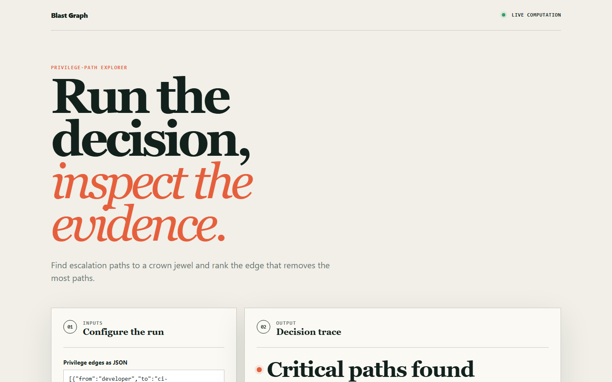
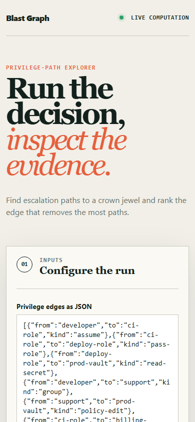

# blastgraph

> Cloud IAM analysis that traverses privilege-escalation paths to crown-jewel resources instead of listing over-permissive policies.

## Live deployment

[](https://github.com/SlateGitOrg/blastgraph/actions/workflows/ci.yml)

[Open the working Blast Graph application](https://slategitorg.github.io/blastgraph/)

This deployed application runs the project's decision workflow in the browser. Change the inputs, run the analysis, and inspect the computed metrics and decision trace.

### Desktop



### Mobile



`FLAGSHIP` · **Cybersecurity** · Advanced · ~4-5 weeks · Fintech - multi-account AWS estate

**Primary language:** TypeScript
**Tags:** `iam`, `graph-analysis`, `duckdb`, `recursive-sql`, `cloud-security`, `terraform`

---

## The problem

A reviewer looks at a role and concludes it is fine. But that role can assume a second role, which can pass a third to a Lambda, which can read the KMS key that decrypts the customer database. No single-policy review finds that path - and this is how most cloud breaches actually escalate. The estate passes every audit and is still four hops from disaster.

## ⭐ The differentiator

Builds a **directed privilege graph and computes transitive escalation reachability to labelled crown-jewel resources**, evaluating condition keys and permission boundaries rather than producing a flat list of over-permissive policies. It reports each path with the **specific action sequence**, making it an incident-prevention artefact rather than a findings count. It also answers the counterfactual nobody else does: which single edge removal kills the most paths.

This is the sentence to lead with when someone asks you to walk through the
project. Everything else in this repo exists to make it true and to prove it.

## Data

A Terraform-defined lab estate on **LocalStack** (free, offline) producing realistic multi-account IAM, plus public AWS policy corpora. **Planted escalation paths of known length** make reachability recall a measured number rather than a claim.

> No paid API key is required to run or demo this project. Where a paid
> service would add value it is wired as an optional enhancement behind an
> interface with an offline mock as the default implementation.

## Stack

- TypeScript
- DuckDB (recursive CTEs do the reachability - the SQL is the interesting artefact)
- LocalStack + Terraform for the lab estate
- Vitest

## Core capabilities

- IAM ingestion normalised into a principal / action / resource edge model
- Condition-key and permission-boundary evaluation that prunes non-viable edges
- Recursive reachability queries producing ranked paths to tagged crown jewels
- Counterfactual mode: recompute reachability with any edge removed, ranked by paths eliminated
- Path explorer showing the exact CLI sequence an attacker would run

## Repository layout

```
src/ingest/
src/graph/
sql/                      # reachability.sql - the core of the project
lab/terraform/
test/paths/
docs/
```

## Build plan

1. Build the lab estate with planted paths first and write down every path you planted.
2. Get the edge model right - condition keys are where naive tools produce fiction.
3. Recursive reachability in SQL. Resist doing it in application code; the SQL is more defensible and faster.
4. Counterfactual analysis last - it is what turns findings into a remediation plan.

## Testing strategy

Assert **100% recall on planted paths** and report the false-path rate honestly. Assert boundary conditions correctly prune edges: a policy allowed only from a specific VPC must not produce a path from outside it - the false positive that destroys trust in this class of tool.

Tests assert **correctness**, not merely that the code runs. A green suite on
this repo is a claim about behaviour under adversarial conditions; treat any
test that would pass against a deliberately broken implementation as a bug in
the test.

## Quality & safety layer

A documented threat model stating initial-access assumptions and explicit non-coverage (data-plane paths, resource policies outside the modelled set). The tool reads configuration only; it never attempts an escalation.

## Measurable outcome

> Finds all 18 planted escalation paths, including three of length four or more that per-policy review misses, and names the single edge removal that eliminates the most paths.

State it in these terms — business units, not technical ones — in your CV
bullet and in the first thirty seconds of describing the project.

## Interview questions this project answers

- **Walk me through a privilege-escalation chain in AWS IAM.**
- **Why is per-policy review insufficient?**
- **How do permission boundaries change reachability?**

## What this deliberately is *not*

- Not an exploitation tool. It computes reachability from configuration; it does not attempt any action.
- Not a CSPM replacement - it does one analysis the CSPM tools do badly.


## Run it now

```bash
npm test        # runs the suite; no install step needed
npm run demo    # the 60-second artefact
```

Requires Node 22.6+ (24 recommended). TypeScript runs natively via
type stripping - there is no build step and no `node_modules`.

## Getting started

```bash
git clone <your-fork-url> blastgraph
cd blastgraph
docker compose up -d          # LocalStack
terraform -chdir=lab/terraform apply -auto-approve
npm install
npm run ingest
npm run paths -- --to tag:crown-jewel
npm run test:paths            # recall against planted ground truth
```

Docker is supported but optional — every path above works on a plain
Windows/macOS/Linux laptop without a cloud account.

## Definition of done

- [ ] The differentiator above is implemented, and a test proves it
- [ ] The measurable outcome is produced by a command anyone can run
- [ ] `README` explains the one decision a generic version gets wrong
- [ ] CI runs the full suite on every push and is green on `main`
- [ ] A recruiter can see the headline artefact in under 60 seconds

## Licence

MIT — see [LICENSE](LICENSE).
